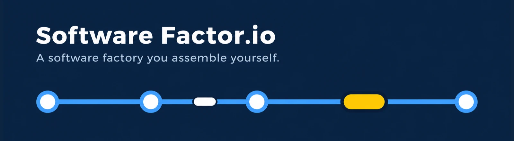
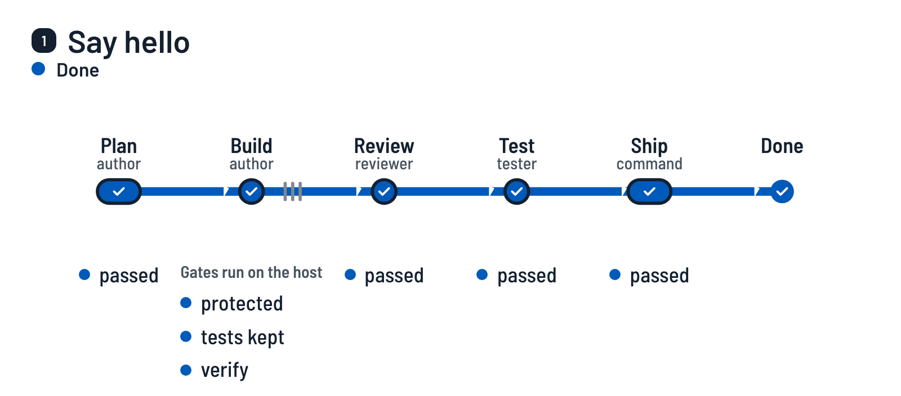
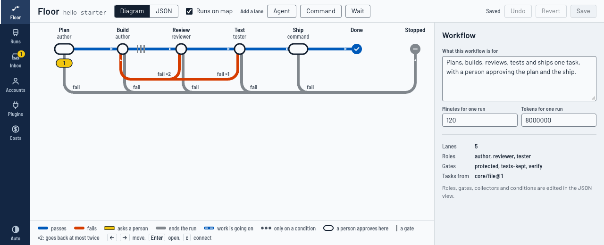

<h1></h1>

[](https://github.com/aindong/software-factor.io/actions/workflows/ci.yml)

[简体中文](docs/i18n/README.zh-CN.md) · [日本語](docs/i18n/README.ja.md) · [Español](docs/i18n/README.es.md)

**A software factory you assemble yourself.** You describe your own way of working as lanes, say what checks
each lane's work, and say where a person steps in. Coding agents you already have installed (Claude Code, Codex)
work the lanes. The host, not the agent, decides whether a lane's work passes.

<picture>
  <source media="(prefers-color-scheme: dark)" srcset="docs/media/how-it-works-dark.webp">
  
</picture>

<sub>A first run on the workflow that `softwarefactor init` writes, recorded from the real interface on the scripted
agent: [how it is made](docs/demo.md).</sub>

This is version 0.0.0 and early. What has run with real agents, and what has not, is listed near the end.

## How it works

A workflow is a line of lanes. This is the one `softwarefactor init` writes:

```
softwarefactor run
  plan     an agent writes a plan          a person approves it
  build    an agent writes the change      gates: protected files, tests kept, your own checks
  review   an agent reads the change       it can send the work back, twice at most
  test     an agent tries the change       it can send the work back once
  ship     a command you define            a person approves before it runs
```

- A **lane** is one step: an agent with a prompt, a command of yours, or a wait.
- A **gate** is a check that the host runs on a clean checkout of the commit the lane left. What the agent says
  about its own work is never the verdict.
- A **checkpoint** is where a person comes in: the run waits for an approval, or the person is only told.
- A **run** keeps everything: each lane's hand-off, each gate's output, and each agent start with its tokens
  and cost.

The process is data: one JSON file per workflow, with no account, model or secret in it, so the same file runs
on another machine.

## What you get

- **Lanes and gates.** An agent's claim is never the verdict. Gates run on a clean checkout of the commit the
  lane left: your own checks, a guard on CI and agent configuration, tests that were deleted or weakened, a new
  test that passes without the change, and a gate you can add for a secret in any commit of the change.
- **A record.** Every run keeps its evidence, each agent start with its tokens and cost, and the transcript the
  agent's CLI printed. `softwarefactor cost --check` proves the cost report against those records.
- **A floor to look at.** `softwarefactor ui` serves a local page: the workflow as a line diagram you can edit,
  runs with their evidence, an inbox for what waits for you, accounts and costs.
- **People leave the loop in steps.** A lane that was approved unchanged often enough earns a suggestion to move
  from "a person approves" to "a person is told". A defect that got through moves it back.
- **Its own checks.** `softwarefactor eval` runs seeded faults through the factory and fails when one gets
  through.

## Quick start

You need Node 24 or newer, git and pnpm. No agent login is needed: the first run uses a scripted stand-in for an
agent, so you see the whole path in a few minutes at no cost.

<!-- quick-start:begin -->
```sh
git clone https://github.com/aindong/software-factor.io.git
cd software-factor.io
pnpm install
pnpm run build
alias softwarefactor="node \"$PWD/dist/cli.js\""

# a small project to try it on
mkdir ../hello-factory && cd ../hello-factory
git init -b main
printf '{ "name": "hello", "private": true, "scripts": { "test": "node --test" } }\n' > package.json
git add -A && git commit -m "start"

softwarefactor init
git add -A && git commit -m "a factory"
softwarefactor run
softwarefactor inbox
softwarefactor approve <run>
softwarefactor inbox
softwarefactor approve <run>
softwarefactor runs
```
<!-- quick-start:end -->

`softwarefactor init` writes `.factor/` with a workflow of five lanes, Plan, Build, Review, Test and Ship, and a
first task, "Say hello". `softwarefactor run` takes the task through the Plan lane: the scripted agent writes a
plan, and the run waits for you (exit code 3 means "waits", not "failed"). `softwarefactor inbox` shows the run's
id. Put it in place of `<run>`. The first approval is of the plan: Build, Review and Test run, the gates check
the commit Build left, and the run waits again before Ship. The second approval lets Ship merge the run's branch
into the branch you started from, on your machine and with nothing pushed. Then the run is done, `softwarefactor
runs` says so, and `FACTOR-HELLO.md` is in your project.

If git asks who you are at the first commit, set `git config user.email` and `user.name` first. In a project of
your own, `init` finds the test command (`pnpm test`, `cargo test`, `go test ./...`, `pytest`). If it finds none
it says so: set `commands.verify` in `.factor/factory.json`, or the first run stops at the gate `verify`.

## The interface

```sh
softwarefactor ui
```

It prints an address on your own machine. The page shows the workflow as a line diagram you can edit, each run
with its evidence one key press away, an inbox for what waits for you, and accounts and costs. More in
[the interface](docs/interface.md).



## Use a real agent

The factory starts the CLIs you already use, with the logins they already have. It stores where a login's
profile folder is, never a key or a token.

```sh
softwarefactor account add work --agent claude --profile ~/.claude
softwarefactor account add codex --agent codex --profile ~/.codex
softwarefactor role bind author --account work --large opus --medium sonnet
```

The workflow that `init` writes has three roles: `author`, `reviewer` and `tester`. `reviewer` and `tester` are
bound the same way as `author`, and may share a login; the review works best on a login of another vendor.

Write tasks as open boxes in `.factor/tasks.md`, or collect them from GitHub issues, a schedule or an MCP server
([collectors](docs/collectors.md)). More in [accounts, roles and the guard](docs/accounts.md).

## The workflows that ship

| Workflow | What it is |
| --- | --- |
| `full-loop` | Plan with a verification contract, build with tests first, state the impact, review with a panel from another vendor, check the interface in a browser, ship. A person approves the plan and the ship. |
| `bugfix-fast` | Collect labelled bug reports, fix each with a test that fails without the fix, open a pull request. |
| `research-only` | Answer a question with a report that cites its sources. A second agent tries to knock it down. No code is changed. |

To use one, copy it from `workflows/` into `.factor/workflows/`, name it in `.factor/factory.json`
(`"workflow": "bugfix-fast"`), define the commands it asks for there, and run `softwarefactor check`.
`full-loop` needs nothing of the author's setup: its first gate, `core/plan-contract@1`, is built in and checks that
the plan names a check for each acceptance criterion, and its `verify-ui` lane uses the public skill `playwright-cli`.

## Guides

- [The workflow file](docs/workflow-schema.md): lanes, gates, transitions, checkpoints.
- [Write a lane](docs/write-a-lane.md), and [write a plugin](docs/plugins.md) for a lane, gate or collector type
  of your own.
- [Collectors](docs/collectors.md): where tasks come from.
- [Accounts, roles and the guard](docs/accounts.md), and [skills and servers on a lane](docs/skills-and-servers.md).
- [The hand-off](docs/handoff.md) and [panels](docs/panels.md).
- [Memory and the factor server](docs/memory.md).
- [The interface](docs/interface.md).
- [Operations](docs/operations.md): the same actions for the interface, the command line and your own agent.
- [Sharing a workflow](docs/sharing.md): export and import.
- [The autonomy ladder](docs/ladder.md) and [retros and lessons](docs/retros.md).
- [Evals](docs/evals.md) and [costs](docs/costs.md).
- The words used are defined in [CONTEXT.md](CONTEXT.md). The decisions and their reasons are in
  [docs/adr](docs/adr).

## What has run with real agents, and what has not

This is version 0.0.0. Most of what is described above has only run on the scripted agent and on stand-ins.

Run with real agents, on the author's own subscription logins:

- One task in a scratch project, built on Claude Code and reviewed on Codex, with the Codex lane reading a
  memory note the Claude lane wrote (2026-11-10).
- The factory on its own repository with the workflow that is now `full-loop` (in those runs it had another name,
  its author's own skills and its own plan check): seven runs, of which five tasks landed (one of them after
  its review sent work back to the build lane) and two stopped on faults of the factory that were then fixed. See
  [what the factory has done on itself](docs/dogfood.md) for each task, its rounds and its cost. The checkpoints
  in those runs were approved by the AI agent that the author set to build this project, acting as the operator.
  No person read those plans before they were approved.
- The GitHub issues collector against the real `gh` (read only), and `softwarefactor add` from a GitHub
  repository.

Only on the scripted agent or a stand-in:

- The eval suite, by design: it starts no real agent.
- Two runs at the same time on separate slots.
- `bugfix-fast` and `research-only` end to end, with stand-ins for `gh` and for the command that opens a pull
  request. `full-loop` also runs end to end on the scripted agent, with its own gate `core/plan-contract@1`; no real agent has
  written a plan for that gate yet.
- One part of `full-loop` that the real runs did not reach: its `verify-ui` lane, the check of a change to the
  interface in a browser. No real task touched the interface.
- The gate `core/no-secrets@1` is in no workflow that ships and not in the one `init` writes: it has only run
  in tests and in the eval suite.
- The Kimi adapter: written from its documentation, tested against a stand-in binary, never the real CLI.
- The `command` adapter (any command of yours as an agent): scripted commands in tests only.
- Each login's limits as its CLI reports them, on the Accounts page and in `account list`: read from
  `claude -p /usage` with a stand-in CLI only. Whether the real CLI prints those lines without a model call is
  not checked.
- A collector on an MCP server (the Jira case), and installing a skill for a run: stand-ins only. So are the skills and profile servers a lane may use (see [the guide](docs/skills-and-servers.md)): no real agent has called a skill or a server through them.
- The autonomy ladder and retros: scripted runs. No lane has yet earned a step on real work.
- The interface is checked in a real browser, driven by keyboard, on runs of the scripted agent.

Known limits are listed at the end of each guide. Two that matter most: an agent that is held only by the guard
(not by an operating system sandbox) can do what your user can do, and a panel's members share one worktree.

## Develop

```sh
pnpm install
pnpm run typecheck && pnpm run lint && pnpm run build && pnpm test
softwarefactor eval
```

The tests start no real agent and need no network.

The recording at the top of this page is made with `pnpm run demo:film`. [The demo](docs/demo.md) says what it
needs and when to record it again.

To send a change, read [CONTRIBUTING.md](CONTRIBUTING.md).

## License

MIT. See [LICENSE](LICENSE).
