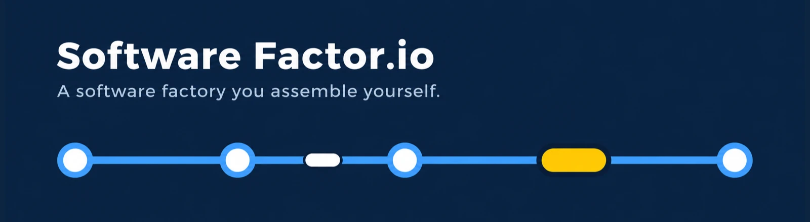
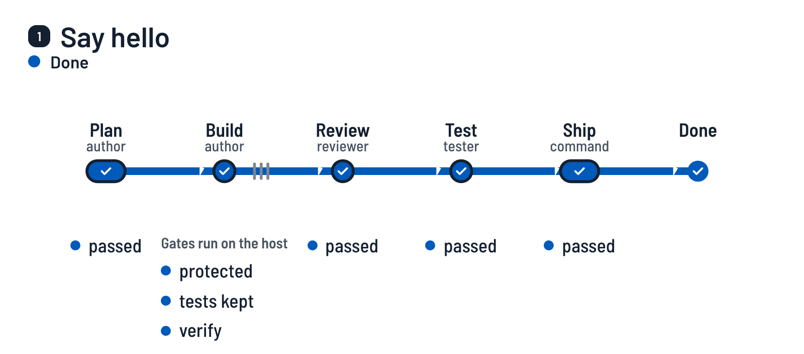
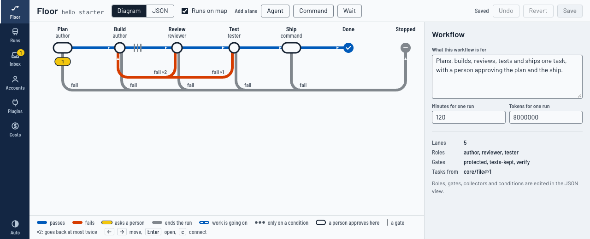

<h1></h1>

[](https://github.com/aindong/software-factor.io/actions/workflows/ci.yml)

[English](../../README.md) · [简体中文](README.zh-CN.md) · [日本語](README.ja.md) · Español

Esta página es una traducción del README en inglés. La página en inglés es la fuente y, donde difieran, la correcta es la página en inglés.

**Una fábrica de software que montas tú mismo.** Describes tu propia manera de trabajar como carriles (lanes), indicas qué comprueba el trabajo de cada carril y dices dónde interviene una persona. Los agentes de programación que ya tienes instalados (Claude Code, Codex) trabajan los carriles. Quien decide si el trabajo de un carril pasa es el host, no el agente.

<picture>
  <source media="(prefers-color-scheme: dark)" srcset="../media/how-it-works-dark.webp">
  
</picture>

<sub>Una primera ejecución en el flujo de trabajo que escribe `softwarefactor init`, grabada desde la interfaz real con el
agente con guion: [cómo se hace](../demo.md).</sub>

Esta es la versión 0.0.0 y está en una fase temprana. Lo que se ha ejecutado con agentes reales y lo que no se enumera cerca del final.

## Cómo funciona

Un flujo de trabajo es una línea de carriles (lanes). Este es el que escribe `softwarefactor init`:

```
softwarefactor run
  plan     an agent writes a plan          a person approves it
  build    an agent writes the change      gates: protected files, tests kept, your own checks
  review   an agent reads the change       it can send the work back, twice at most
  test     an agent tries the change       it can send the work back once
  ship     a command you define            a person approves before it runs
```

- Un **carril** (lane) es un paso: un agente con un prompt, un comando tuyo o una espera.
- Una **compuerta** (gate) es una comprobación que el host ejecuta sobre una copia limpia del commit que dejó el carril. Lo que el agente dice de su propio trabajo nunca es el veredicto.
- Un **punto de control** (checkpoint) es donde interviene una persona: la ejecución espera una aprobación, o solo se avisa a la persona.
- Una **ejecución** (run) lo guarda todo: el traspaso (hand-off) de cada carril, la salida de cada compuerta y cada arranque de un agente con sus tokens y su coste.

El proceso son datos: un archivo JSON por flujo de trabajo, sin cuenta, modelo ni secreto dentro, de modo que el mismo archivo funciona en otra máquina.

## Qué obtienes

- **Carriles y compuertas.** La afirmación de un agente nunca es el veredicto. Las compuertas se ejecutan sobre una copia limpia del commit que dejó el carril: tus propias comprobaciones, una protección de la configuración de CI y de agentes, pruebas que se borraron o se debilitaron, una prueba nueva que pasa sin el cambio y una compuerta que puedes añadir para detectar un secreto en cualquier commit del cambio.
- **Un registro.** Cada ejecución conserva sus evidencias, cada arranque de un agente con sus tokens y su coste, y la transcripción que imprimió la CLI del agente. `softwarefactor cost --check` comprueba el informe de costes contra esos registros.
- **Un panel para mirar.** `softwarefactor ui` sirve una página local: el flujo de trabajo como un diagrama de línea que puedes editar, las ejecuciones con sus evidencias, una bandeja para lo que espera por ti, y las cuentas y los costes.
- **Las personas salen del ciclo por etapas.** Un carril que se aprobó sin cambios las veces suficientes recibe la sugerencia de pasar de "una persona aprueba" a "se avisa a una persona". Un defecto que se cuela lo devuelve al estado anterior.
- **Sus propias comprobaciones.** `softwarefactor eval` pasa por la fábrica fallos sembrados a propósito y falla cuando uno se cuela.

## Inicio rápido

Necesitas Node 24 o posterior, git y pnpm. No hace falta iniciar sesión en ningún agente: la primera ejecución usa un sustituto con guion en lugar de un agente, así que ves todo el recorrido en pocos minutos y sin coste.

<!-- quick-start:begin -->
```sh
git clone https://github.com/aindong/software-factor.io.git
cd software-factor.io
pnpm install
pnpm run build
alias softwarefactor="node \"$PWD/dist/cli.js\""

# a small project to try it on
mkdir ../hello-factory && cd ../hello-factory
git init -b main
printf '{ "name": "hello", "private": true, "scripts": { "test": "node --test" } }\n' > package.json
git add -A && git commit -m "start"

softwarefactor init
git add -A && git commit -m "a factory"
softwarefactor run
softwarefactor inbox
softwarefactor approve <run>
softwarefactor inbox
softwarefactor approve <run>
softwarefactor runs
```
<!-- quick-start:end -->

`softwarefactor init` escribe `.factor/` con un flujo de trabajo de cinco carriles, Plan, Build, Review, Test y Ship, y una primera tarea, "Say hello". `softwarefactor run` lleva la tarea por el carril Plan: el agente con guion escribe un plan y la ejecución te espera (el código de salida 3 significa "espera", no "fallo"). `softwarefactor inbox` muestra el id de la ejecución. Ponlo en lugar de `<run>`. La primera aprobación es la del plan: se ejecutan Build, Review y Test, las compuertas comprueban el commit que dejó Build y la ejecución vuelve a esperar antes de Ship. La segunda aprobación deja que Ship fusione la rama de la ejecución en la rama desde la que empezaste, en tu máquina y sin enviar nada. Entonces la ejecución termina, `softwarefactor runs` lo indica y `FACTOR-HELLO.md` está en tu proyecto.

Si git te pregunta quién eres en el primer commit, configura antes `git config user.email` y `user.name`. En un proyecto tuyo, `init` encuentra el comando de pruebas (`pnpm test`, `cargo test`, `go test ./...`, `pytest`). Si no encuentra ninguno, lo dice: define `commands.verify` en `.factor/factory.json`, o la primera ejecución se detendrá en la compuerta `verify`.

## La interfaz

```sh
softwarefactor ui
```

Imprime una dirección en tu propia máquina. La página muestra el flujo de trabajo como un diagrama de línea que puedes editar, cada ejecución con sus evidencias a una pulsación de tecla, una bandeja para lo que espera por ti, y las cuentas y los costes. Más en [la interfaz](../interface.md).



## Usar un agente real

La fábrica arranca las CLI que ya usas, con las sesiones que ya tienen. Guarda dónde está la carpeta de perfil de una sesión, nunca una clave ni un token.

```sh
softwarefactor account add work --agent claude --profile ~/.claude
softwarefactor account add codex --agent codex --profile ~/.codex
softwarefactor role bind author --account work --large opus --medium sonnet
```

El flujo de trabajo que escribe `init` tiene tres roles: `author`, `reviewer` y `tester`. `reviewer` y `tester` se vinculan igual que `author` y pueden compartir una sesión; la revisión funciona mejor con una sesión de otro proveedor.

Escribe las tareas como casillas sin marcar en `.factor/tasks.md`, o recógelas de issues de GitHub, de una programación o de un servidor MCP ([recolectores](../collectors.md)). Más en [cuentas, roles y la guarda](../accounts.md).

## Los flujos de trabajo incluidos

| Flujo de trabajo | Qué es |
| --- | --- |
| `full-loop` | Planificar con un contrato de verificación, construir empezando por las pruebas, exponer el impacto, revisar con un panel de otro proveedor, comprobar la interfaz en un navegador y entregar. Una persona aprueba el plan y la entrega. |
| `bugfix-fast` | Recoger informes de errores etiquetados, corregir cada uno con una prueba que falla sin la corrección y abrir una pull request. |
| `research-only` | Responder una pregunta con un informe que cita sus fuentes. Un segundo agente intenta derribarlo. No se cambia ningún código. |

Para usar uno, cópialo de `workflows/` a `.factor/workflows/`, nómbralo en `.factor/factory.json` (`"workflow": "bugfix-fast"`), define allí los comandos que pide y ejecuta `softwarefactor check`. `full-loop` no necesita nada del entorno de su autor: su primera compuerta, `core/plan-contract@1`, está incluida y comprueba que el plan nombre una comprobación para cada criterio de aceptación, y su carril `verify-ui` usa la skill pública `playwright-cli`.

## Guías

- [El archivo de flujo de trabajo](../workflow-schema.md): carriles, compuertas, transiciones, puntos de control.
- [Escribir un carril](../write-a-lane.md), y [escribir un plugin](../plugins.md) para un tipo propio de carril, compuerta o recolector.
- [Recolectores](../collectors.md): de dónde vienen las tareas.
- [Cuentas, roles y la guarda](../accounts.md).
- [El traspaso](../handoff.md) y [los paneles](../panels.md).
- [La memoria y el servidor factor](../memory.md).
- [La interfaz](../interface.md).
- [Operaciones](../operations.md): las mismas acciones para la interfaz, la línea de comandos y tu propio agente.
- [Compartir un flujo de trabajo](../sharing.md): exportar e importar.
- [La escalera de autonomía](../ladder.md) y [retrospectivas y lecciones](../retros.md).
- [Evaluaciones](../evals.md) y [costes](../costs.md).
- Las palabras que se usan están definidas en [CONTEXT.md](../../CONTEXT.md). Las decisiones y sus razones están en [docs/adr](../adr).

## Lo que se ha ejecutado con agentes reales y lo que no

Esta es la versión 0.0.0. Casi todo lo descrito arriba solo se ha ejecutado con el agente con guion y con sustitutos.

Ejecutado con agentes reales, con las sesiones de la suscripción del propio autor:

- Una tarea en un proyecto de prueba, construida con Claude Code y revisada en Codex, con el carril de Codex leyendo una nota de memoria que escribió el carril de Claude (2026-11-10).
- La fábrica sobre su propio repositorio con el flujo que ahora se llama `full-loop` (en esas ejecuciones tenía otro nombre, las skills de su autor y su propia comprobación del plan): siete ejecuciones, de las cuales cinco tareas se integraron (una de ellas después de que su revisión devolviera el trabajo al carril de build) y dos se detuvieron por fallos de la fábrica que luego se corrigieron. Consulta [lo que la fábrica ha hecho sobre sí misma](../dogfood.md) para ver cada tarea, sus rondas y su coste. Los puntos de control de esas ejecuciones los aprobó el agente de IA que el autor puso a construir este proyecto, actuando como operador. Ninguna persona leyó esos planes antes de que se aprobaran.
- El recolector de issues de GitHub contra el `gh` real (solo lectura), y `softwarefactor add` desde un repositorio de GitHub.

Solo con el agente con guion o con un sustituto:

- La suite de evaluación, por diseño: no arranca ningún agente real.
- Dos ejecuciones a la vez en ranuras (slots) separadas.
- `bugfix-fast` y `research-only` de principio a fin, con sustitutos de `gh` y del comando que abre una pull request. `full-loop` también se ejecuta de principio a fin con el agente con guion, con su propia compuerta `core/plan-contract@1`; ningún agente real ha escrito todavía un plan para esa compuerta.
- Una parte de `full-loop` que las ejecuciones reales no alcanzaron: su carril `verify-ui`, la comprobación de un cambio en la interfaz en un navegador. Ninguna tarea real tocó la interfaz.
- La compuerta `core/no-secrets@1` no está en ningún flujo de trabajo incluido ni en el que escribe `init`: solo se ha ejecutado en pruebas y en la suite de evaluación.
- El adaptador de Kimi: escrito a partir de su documentación, probado contra un binario sustituto, nunca con la CLI real.
- El adaptador `command` (cualquier comando tuyo como agente): solo comandos con guion en las pruebas.
- Un recolector sobre un servidor MCP (el caso de Jira) y la instalación de una skill para una ejecución: solo sustitutos.
- La escalera de autonomía y las retrospectivas: ejecuciones con guion. Ningún carril ha ganado todavía un peldaño con trabajo real.
- La interfaz se comprueba en un navegador real, manejado con el teclado, sobre ejecuciones del agente con guion.

Los límites conocidos se enumeran al final de cada guía. Dos de los que más importan: un agente que solo está contenido por la guarda (y no por un sandbox del sistema operativo) puede hacer lo que puede hacer tu usuario, y los miembros de un panel comparten un mismo worktree.

## Desarrollo

```sh
pnpm install
pnpm run typecheck && pnpm run lint && pnpm run build && pnpm test
softwarefactor eval
```

Las pruebas no arrancan ningún agente real y no necesitan red.

La grabación de la parte superior de esta página se hace con `pnpm run demo:film`. [La demo](../demo.md) dice qué necesita y cuándo conviene volver a grabarla.

Para enviar un cambio, lee [CONTRIBUTING.md](../../CONTRIBUTING.md).

## Licencia

MIT. Consulta [LICENSE](../../LICENSE).
