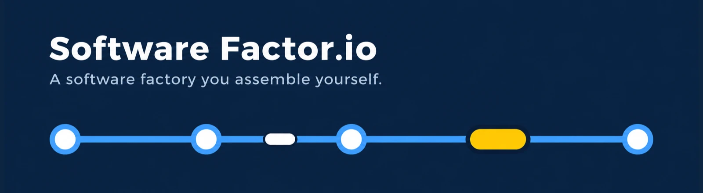
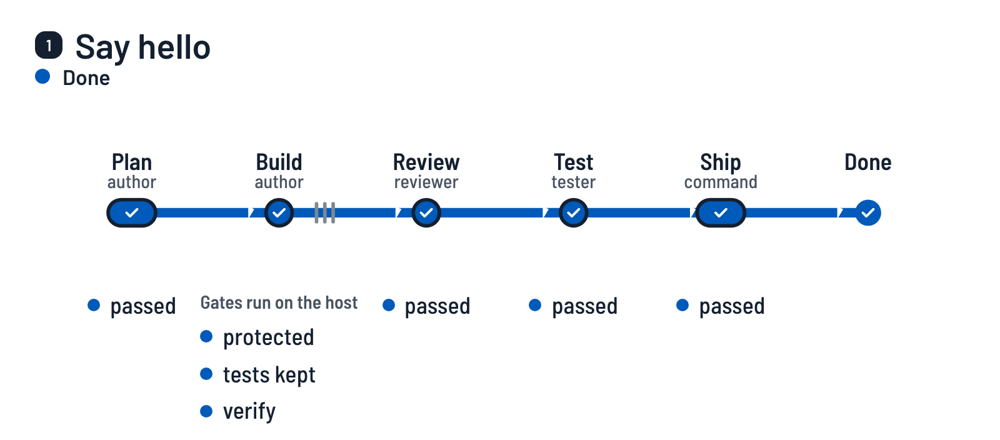
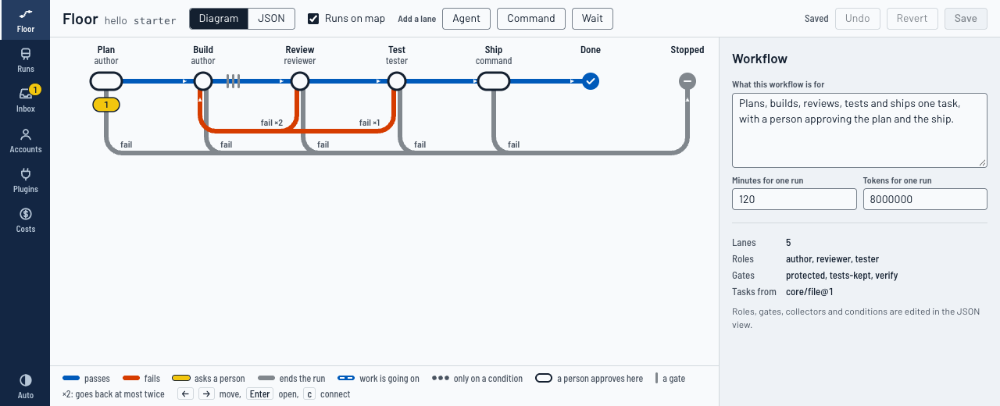

<h1></h1>

[](https://github.com/aindong/software-factor.io/actions/workflows/ci.yml)

[English](../../README.md) · [简体中文](README.zh-CN.md) · 日本語 · [Español](README.es.md)

このページは英語版 README の翻訳です。英語版が原本であり、両者に違いがある場合は英語版が正しい内容です。

**自分で組み立てるソフトウェア工場。** 自分の仕事の進め方をレーン（lane）として書き表し、各レーンの成果物を何で検査するかを決め、
どこで人が関わるかを指定します。すでに入れてあるコーディングエージェント（Claude Code、Codex）がレーンの作業をします。
レーンの成果物が通るかどうかを決めるのはホストであり、エージェントではありません。

<picture>
  <source media="(prefers-color-scheme: dark)" srcset="../media/how-it-works-dark.webp">
  
</picture>

<sub>`softwarefactor init` が書き出すワークフローでの最初の実行を、スクリプトのエージェントを使って実際のインターフェースから録画したものです。
[作り方](../demo.md)。</sub>

バージョンは 0.0.0 で、まだ初期の段階です。実際のエージェントで動かしたものと動かしていないものは、末尾近くに一覧しています。

## 仕組み

ワークフローは、レーン（lane）が並んだ 1 本の線です。`softwarefactor init` が書き出すのは次のものです。

```
softwarefactor run
  plan     an agent writes a plan          a person approves it
  build    an agent writes the change      gates: protected files, tests kept, your own checks
  review   an agent reads the change       it can send the work back, twice at most
  test     an agent tries the change       it can send the work back once
  ship     a command you define            a person approves before it runs
```

- **レーン**（lane）は 1 つの段階です。プロンプトを持つエージェント、自分で用意したコマンド、または待機のいずれかです。
- **ゲート**（gate）は、レーンが残したコミットのクリーンなチェックアウト上でホストが実行する検査です。エージェントが自分の作業について述べたことは、判定にはなりません。
- **チェックポイント**（checkpoint）は、人が関わる地点です。実行は承認を待つか、人には知らせるだけで進みます。
- **実行**（run）はすべてを記録します。各レーンの引き継ぎ（hand-off）、各ゲートの出力、エージェントを起動するたびのトークン数とコストです。

プロセスはデータです。ワークフローごとに JSON ファイルが 1 つあり、アカウントもモデルもシークレットも含まれないので、同じファイルを別のマシンでもそのまま動かせます。

## できること

- **レーンとゲート。** エージェントの主張が判定になることはありません。ゲートは、レーンが残したコミットのクリーンなチェックアウト上で動きます。自分で書いた検査、CI とエージェント設定の保護、削除または弱められたテスト、変更がなくても通ってしまう新しいテスト、そして変更に含まれるどのコミットにもシークレットがないかを見るために追加できるゲートがあります。
- **記録。** 実行ごとに、証拠、エージェント起動ごとのトークン数とコスト、エージェントの CLI が出力したトランスクリプトが残ります。`softwarefactor cost --check` は、これらの記録を使ってコストレポートを検証します。
- **見渡せる場所。** `softwarefactor ui` はローカルのページを提供します。編集できる線図としてのワークフロー、証拠つきの実行、対応待ちの受信箱、アカウントとコストが見られます。
- **人は段階的にループから外れます。** 変更なしで十分な回数承認されたレーンには、「人が承認する」から「人に知らせる」へ移す提案が出ます。欠陥が通り抜けたときは、元に戻ります。
- **自前の検査。** `softwarefactor eval` は、仕込んだ不具合を工場に流し、1 つでも通り抜けると失敗にします。

## クイックスタート

必要なのは Node 24 以降、git、pnpm です。エージェントへのログインは不要です。最初の実行ではスクリプトで動くエージェントの代役を使うので、費用をかけずに数分で全体の流れを確認できます。

<!-- quick-start:begin -->
```sh
git clone https://github.com/aindong/software-factor.io.git
cd software-factor.io
pnpm install
pnpm run build
alias softwarefactor="node \"$PWD/dist/cli.js\""

# a small project to try it on
mkdir ../hello-factory && cd ../hello-factory
git init -b main
printf '{ "name": "hello", "private": true, "scripts": { "test": "node --test" } }\n' > package.json
git add -A && git commit -m "start"

softwarefactor init
git add -A && git commit -m "a factory"
softwarefactor run
softwarefactor inbox
softwarefactor approve <run>
softwarefactor inbox
softwarefactor approve <run>
softwarefactor runs
```
<!-- quick-start:end -->

`softwarefactor init` は `.factor/` を書き出します。中には Plan、Build、Review、Test、Ship の 5 つのレーンからなるワークフローと、最初のタスク「Say hello」が入っています。`softwarefactor run` はそのタスクを Plan レーンに通します。スクリプトのエージェントが計画を書き、実行はあなたを待ちます（終了コード 3 は「待機中」を意味し、「失敗」ではありません）。`softwarefactor inbox` に実行の id が出るので、それを `<run>` の代わりに入れてください。最初の承認は計画に対するものです。Build、Review、Test が動き、ゲートが Build の残したコミットを検査し、Ship の前で実行はもう一度待ちます。2 回目の承認で、Ship がその実行のブランチを、作業を始めたブランチにマージします。マージは自分のマシン上で行われ、何もプッシュされません。そのあと実行は完了し、`softwarefactor runs` にもそう表示され、プロジェクトに `FACTOR-HELLO.md` ができています。

最初のコミットで git に名前を尋ねられたら、先に `git config user.email` と `user.name` を設定してください。自分のプロジェクトでは、`init` がテストコマンド（`pnpm test`、`cargo test`、`go test ./...`、`pytest`）を探します。見つからなければそう表示されるので、`.factor/factory.json` の `commands.verify` を設定してください。設定しないと、最初の実行はゲート `verify` で止まります。

## インターフェース

```sh
softwarefactor ui
```

自分のマシン上のアドレスが表示されます。ページには、編集できる線図としてのワークフロー、キー 1 つで開ける証拠つきの各実行、対応待ちの受信箱、アカウントとコストが出ます。詳しくは[インターフェース](../interface.md)を参照してください。



## 実際のエージェントを使う

工場は、すでに使っている CLI を、すでにあるログインのまま起動します。保存するのはログインのプロファイルフォルダの場所だけで、キーやトークンは保存しません。

```sh
softwarefactor account add work --agent claude --profile ~/.claude
softwarefactor account add codex --agent codex --profile ~/.codex
softwarefactor role bind author --account work --large opus --medium sonnet
```

`init` が書き出すワークフローには、`author`、`reviewer`、`tester` の 3 つのロールがあります。`reviewer` と `tester` も `author` と同じ方法で割り当て、ログインを共有しても構いません。レビューは、別のベンダーのログインで行うのがもっとも効果的です。

タスクは `.factor/tasks.md` に未チェックのボックスとして書くか、GitHub の issue、スケジュール、MCP サーバーから集めます（[コレクター](../collectors.md)）。詳しくは[アカウント、ロール、ガード](../accounts.md)を参照してください。

## 同梱のワークフロー

| ワークフロー | 内容 |
| --- | --- |
| `alleo-loop` | 検証の取り決めつきで計画し、テストを先に書いて作り、影響を書き出し、別のベンダーのパネルでレビューし、ブラウザでインターフェースを確認して、出荷します。計画と出荷は人が承認します。 |
| `bugfix-fast` | ラベルつきのバグ報告を集め、修正なしでは失敗するテストとともに 1 件ずつ直し、プルリクエストを開きます。 |
| `research-only` | 出典を示すレポートで質問に答えます。2 つ目のエージェントがそれを崩そうとします。コードは変更しません。 |

使うには、`workflows/` から `.factor/workflows/` にコピーし、`.factor/factory.json` で名前を指定し（`"workflow": "bugfix-fast"`）、求められるコマンドをそこで定義して、`softwarefactor check` を実行します。`alleo-loop` は作者自身のプロセスです。最初のゲートは `alleo-plan-check` を呼びますが、これは作者の環境にあるツールです。このゲートのコマンドを自分の計画チェックに置き換えるか、ゲートを外してください。

## ガイド

- [ワークフローファイル](../workflow-schema.md)：レーン、ゲート、遷移、チェックポイント。
- [レーンを書く](../write-a-lane.md)、および、独自のレーン、ゲート、コレクターの種類を作るための[プラグインを書く](../plugins.md)。
- [コレクター](../collectors.md)：タスクの出どころ。
- [アカウント、ロール、ガード](../accounts.md)。
- [引き継ぎ](../handoff.md)と[パネル](../panels.md)。
- [メモリと factor サーバー](../memory.md)。
- [インターフェース](../interface.md)。
- [オペレーション](../operations.md)：インターフェース、コマンドライン、自分のエージェントで共通の操作。
- [ワークフローの共有](../sharing.md)：エクスポートとインポート。
- [自律のはしご](../ladder.md)と[振り返りと教訓](../retros.md)。
- [評価](../evals.md)と[コスト](../costs.md)。
- 使っている用語は [CONTEXT.md](../../CONTEXT.md) で定義しています。決定とその理由は [docs/adr](../adr) にあります。

## 実際のエージェントで動かしたもの、動かしていないもの

バージョンは 0.0.0 です。上で説明した内容の大半は、スクリプトのエージェントと代役でしか動かしていません。

実際のエージェントで動かしたもの（作者自身のサブスクリプションのログインを使用）。

- 試用プロジェクトでの 1 つのタスク。Claude Code で作り、Codex でレビューし、Codex のレーンは Claude のレーンが書いたメモリのノートを読みました（2026-11-10）。
- 工場自身のリポジトリでの `alleo-loop`。実行は 7 回で、5 つのタスクが取り込まれ（うち 1 つは、レビューが作業を Build レーンに差し戻したあと）、2 回は工場自身の不具合で止まり、その不具合は修正済みです。各タスク、そのラウンド数とコストは、[工場が自分自身に対して行ったこと](../dogfood.md)を参照してください。これらの実行のチェックポイントは、作者がこのプロジェクトを作らせた AI エージェントが、オペレーターとして承認しました。承認の前に計画を読んだ人はいません。
- GitHub issue のコレクターを実際の `gh` で動かしたこと（読み取り専用）と、GitHub リポジトリからの `softwarefactor add`。

スクリプトのエージェントまたは代役でしか動かしていないもの。

- 評価スイート。これは設計上そうしています。実際のエージェントは起動しません。
- 別々のスロット（slot）での 2 つの同時実行。
- `bugfix-fast` と `research-only` の最初から最後までの実行。`gh` とプルリクエストを開くコマンドには代役を使いました。`alleo-loop` もスクリプトのエージェントで最後まで動かしましたが、`alleo-plan-check` には代役を使いました。
- 実際の実行が届かなかった `alleo-loop` の一部。`verify-ui` レーン、つまりインターフェースの変更をブラウザで確認する部分です。インターフェースに触れる実際のタスクはありませんでした。
- ゲート `core/no-secrets@1` は、同梱のどのワークフローにも、`init` が書き出すワークフローにも入っていません。テストと評価スイートでしか動かしていません。
- Kimi アダプター：ドキュメントをもとに書き、代役のバイナリに対してテストしましたが、実際の CLI では一度も試していません。
- `command` アダプター（自分のコマンドをエージェントとして使う）：テストでスクリプトのコマンドを使っただけです。
- MCP サーバー上のコレクター（Jira の場合）と、実行のためのスキルのインストール：代役のみです。
- 自律のはしごと振り返り：スクリプトの実行のみです。実際の作業で段階を上がったレーンはまだありません。
- インターフェースは実際のブラウザでキーボード操作により確認しましたが、対象はスクリプトのエージェントの実行です。

既知の制限は、各ガイドの末尾に挙げています。特に重要なのは次の 2 つです。ガードだけで制限されたエージェント（オペレーティングシステムのサンドボックスなし）は、あなたのユーザーができることを何でもできます。また、パネルのメンバーは 1 つの作業ツリーを共有します。

## 開発

```sh
pnpm install
pnpm run typecheck && pnpm run lint && pnpm run build && pnpm test
softwarefactor eval
```

テストは実際のエージェントを起動せず、ネットワークも要りません。

このページ上部の録画は `pnpm run demo:film` で作っています。[デモ](../demo.md)に、必要なものと、撮り直す時期を書いています。

変更を送るときは、まず [CONTRIBUTING.md](../../CONTRIBUTING.md) を読んでください。

## ライセンス

MIT。[LICENSE](../../LICENSE) を参照してください。
