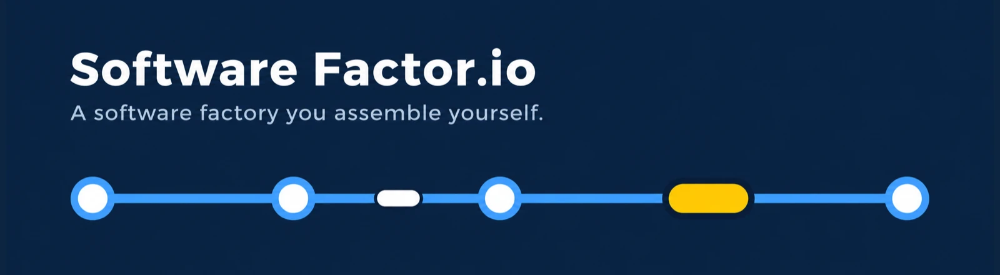
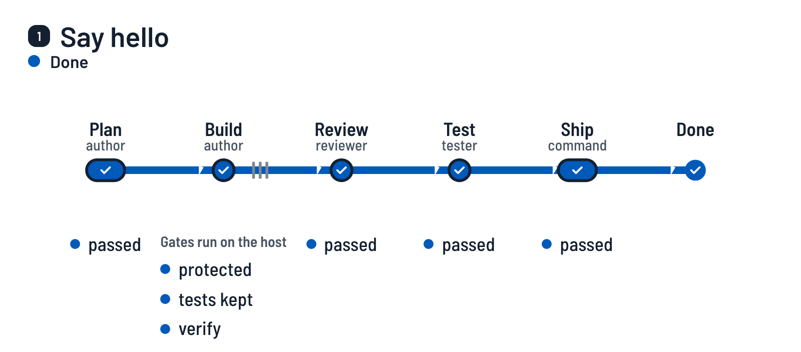
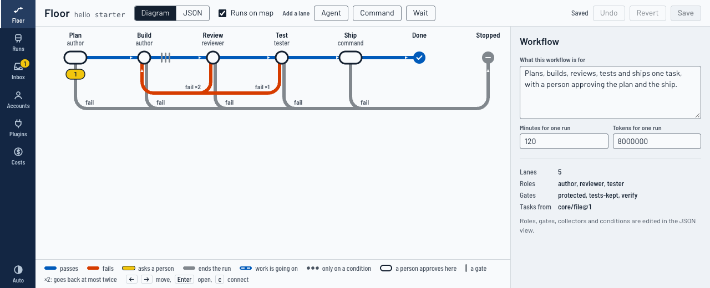

<h1></h1>

简体中文 · [English](../../README.md) · [日本語](README.ja.md) · [Español](README.es.md)

本页是英文 README 的译文。英文页是准绳，两者不一致时，以英文页为准。

**一座由你自己搭建的软件工厂。** 你把自己的工作方式描述为一条条泳道（lane），说明由什么来检查每条泳道的产出，
并指定人在哪里介入。你已经装好的编码智能体（Claude Code、Codex）负责在泳道上干活。泳道的产出能否通过，
由宿主（host）决定，而不是由智能体决定。

<picture>
  <source media="(prefers-color-scheme: dark)" srcset="../media/how-it-works-dark.webp">
  
</picture>

<sub>`softwarefactor init` 所写入的工作流上的一项任务。这是示意图，不是录屏：
[制作方式](../demo.md)。</sub>

当前版本为 0.0.0，尚处早期。哪些部分已经用真实智能体跑过、哪些还没有，列在接近末尾的位置。

## 工作原理

工作流是一条由泳道（lane）串成的线。下面是 `softwarefactor init` 写入的那一条：

```
softwarefactor run
  plan     an agent writes a plan          a person approves it
  build    an agent writes the change      gates: protected files, tests kept, your own checks
  review   an agent reads the change       it can send the work back, twice at most
  test     an agent tries the change       it can send the work back once
  ship     a command you define            a person approves before it runs
```

- **泳道**（lane）是一个步骤：带提示词的智能体、你自己的命令，或一次等待。
- **关卡**（gate）是一项检查，由宿主在泳道留下的提交的干净检出上运行。智能体对自己工作的描述，从来不算结论。
- **检查点**（checkpoint）是人介入的地方：运行等待一次批准，或者只是通知这个人。
- **运行**（run）保存全部内容：每条泳道的交接（hand-off）、每道关卡的输出，以及每次智能体启动及其令牌数和费用。

流程就是数据：每个工作流一个 JSON 文件，里面没有账号、模型或密钥，所以同一个文件可以在另一台机器上运行。

## 你能得到什么

- **泳道与关卡。** 智能体的说法从来不算结论。关卡在泳道所留提交的干净检出上运行：你自己的检查、对 CI 和智能体配置的防护、被删除或被削弱的测试、不依赖变更也能通过的新测试，以及一道你可以自行添加的关卡，用来查出变更中任何一个提交里的密钥。
- **一份记录。** 每次运行都保留它的证据、每次智能体启动的令牌数和费用，以及智能体的 CLI 打印出的完整记录。`softwarefactor cost --check` 会用这些记录核对费用报告。
- **一个可以看的界面。** `softwarefactor ui` 在本地提供一个页面：可以编辑的线形工作流图、附带证据的各次运行、存放等你处理事项的收件箱，以及账号和费用。
- **人是分步退出循环的。** 如果一条泳道多次被原样批准，系统会建议把它从“由人批准”改为“只通知人”。一旦有缺陷漏过，就会改回去。
- **自带的检查。** `softwarefactor eval` 把预先植入的故障送进工厂，只要有一个漏过就判为失败。

## 快速开始

你需要 Node 24 或更新版本、git 和 pnpm。不需要登录任何智能体：第一次运行使用脚本化的智能体替身，所以几分钟内、不花任何费用，就能看到完整的流程。

<!-- quick-start:begin -->
```sh
git clone https://github.com/aindong/software-factor.io.git
cd software-factor.io
pnpm install
pnpm run build
alias softwarefactor="node \"$PWD/dist/cli.js\""

# a small project to try it on
mkdir ../hello-factory && cd ../hello-factory
git init -b main
printf '{ "name": "hello", "private": true, "scripts": { "test": "node --test" } }\n' > package.json
git add -A && git commit -m "start"

softwarefactor init
git add -A && git commit -m "a factory"
softwarefactor run
softwarefactor inbox
softwarefactor approve <run>
softwarefactor inbox
softwarefactor approve <run>
softwarefactor runs
```
<!-- quick-start:end -->

`softwarefactor init` 写入 `.factor/`，其中有一个包含五条泳道的工作流，即 Plan、Build、Review、Test 和 Ship，还有第一项任务“Say hello”。`softwarefactor run` 让这项任务走过 Plan 泳道：脚本化的智能体写出一份计划，然后运行等待你（退出码 3 表示“在等待”，不是“失败”）。`softwarefactor inbox` 会显示这次运行的 id，用它替换 `<run>`。第一次批准针对计划：Build、Review 和 Test 依次运行，关卡检查 Build 留下的提交，运行在 Ship 之前再次等待。第二次批准让 Ship 把这次运行的分支合并到你出发时所在的分支，在你自己的机器上完成，不推送任何东西。然后运行结束，`softwarefactor runs` 会这样显示，你的项目里也有了 `FACTOR-HELLO.md`。

如果 git 在第一次提交时询问你是谁，请先设置 `git config user.email` 和 `user.name`。在你自己的项目里，`init` 会找出测试命令（`pnpm test`、`cargo test`、`go test ./...`、`pytest`）。如果找不到，它会告诉你：请在 `.factor/factory.json` 中设置 `commands.verify`，否则第一次运行会停在关卡 `verify`。

## 界面

```sh
softwarefactor ui
```

它会打印一个指向你本机的地址。页面显示可编辑的线形工作流图、每次运行及其一键可达的证据、存放等你处理事项的收件箱，以及账号和费用。详见[界面](../interface.md)。



## 使用真实的智能体

工厂启动你已经在用的 CLI，使用它们已有的登录。它只保存登录的配置文件夹在哪里，从不保存密钥或令牌。

```sh
softwarefactor account add work --agent claude --profile ~/.claude
softwarefactor account add codex --agent codex --profile ~/.codex
softwarefactor role bind author --account work --large opus --medium sonnet
```

`init` 写入的工作流有三个角色：`author`、`reviewer` 和 `tester`。`reviewer` 和 `tester` 的绑定方式与 `author` 相同，可以共用一个登录；评审最好使用另一家厂商的登录。

把任务写成 `.factor/tasks.md` 中未勾选的复选框，或者从 GitHub issue、定时计划或 MCP 服务器收集（见[收集器](../collectors.md)）。更多内容见[账号、角色与防护](../accounts.md)。

## 随附的工作流

| 工作流 | 说明 |
| --- | --- |
| `alleo-loop` | 先写带验证约定的计划，先写测试再构建，说明影响范围，由来自另一家厂商的评审小组评审，在浏览器中检查界面，然后交付。计划和交付都由人批准。 |
| `bugfix-fast` | 收集带标签的缺陷报告，每个都用一个没有修复就会失败的测试来修复，然后开一个拉取请求。 |
| `research-only` | 用一份引用来源的报告回答一个问题。由第二个智能体设法推翻它。不改动任何代码。 |

要使用其中一个，把它从 `workflows/` 复制到 `.factor/workflows/`，在 `.factor/factory.json` 中指明它（`"workflow": "bugfix-fast"`），在那里定义它要求的命令，然后运行 `softwarefactor check`。`alleo-loop` 是作者自己的流程：它的第一道关卡调用 `alleo-plan-check`，那是作者自己环境里的工具。请把这道关卡的命令换成你自己的计划检查，或者删掉这道关卡。

## 指南

- [工作流文件](../workflow-schema.md)：泳道、关卡、转移、检查点。
- [编写泳道](../write-a-lane.md)，以及[编写插件](../plugins.md)，用于你自己的泳道、关卡或收集器类型。
- [收集器](../collectors.md)：任务从哪里来。
- [账号、角色与防护](../accounts.md)。
- [交接](../handoff.md)与[评审小组](../panels.md)。
- [记忆与 factor 服务器](../memory.md)。
- [界面](../interface.md)。
- [操作](../operations.md)：界面、命令行和你自己的智能体共用同一组动作。
- [分享工作流](../sharing.md)：导出与导入。
- [自主性阶梯](../ladder.md)与[复盘和经验教训](../retros.md)。
- [评测](../evals.md)与[费用](../costs.md)。
- 文中用到的术语在 [CONTEXT.md](../../CONTEXT.md) 中定义。各项决定及其理由见 [docs/adr](../adr)。

## 哪些已用真实智能体跑过，哪些还没有

当前版本为 0.0.0。上文描述的大部分内容，只在脚本化的智能体和替身上跑过。

已用真实智能体跑过，使用的是作者自己订阅的登录：

- 在一个临时项目里做了一项任务，用 Claude Code 构建、用 Codex 评审，其中 Codex 泳道读取了 Claude 泳道写下的一条记忆笔记（2026-11-10）。
- 在工厂自己的仓库上用 `alleo-loop` 跑：共七次运行，其中五项任务落地（有一项是在评审把工作退回 Build 泳道之后），两次因工厂自身的故障而停止，故障随后已修复。每项任务、它的轮次和费用，见[工厂在自身上做过什么](../dogfood.md)。这些运行中的检查点，是由作者安排来构建本项目的 AI 智能体以操作员身份批准的。批准之前，没有人读过这些计划。
- GitHub issue 收集器对真实的 `gh`（只读）的使用，以及 `softwarefactor add` 从一个 GitHub 仓库添加。

只在脚本化的智能体或替身上跑过：

- 评测套件，这是有意为之：它不启动任何真实智能体。
- 在各自独立的槽位（slot）上同时进行两次运行。
- `bugfix-fast` 和 `research-only` 的端到端运行，用的是 `gh` 和开启拉取请求那条命令的替身。`alleo-loop` 也在脚本化的智能体上端到端跑过，用的是 `alleo-plan-check` 的替身。
- `alleo-loop` 中真实运行没有触及的一部分：它的 `verify-ui` 泳道，即在浏览器中检查界面变更。没有哪项真实任务涉及界面。
- 关卡 `core/no-secrets@1` 不在任何随附的工作流里，也不在 `init` 写入的工作流里：它只在测试和评测套件中跑过。
- Kimi 适配器：依据其文档编写，对照替身程序测试过，从未用真实的 CLI 试过。
- `command` 适配器（把你的任意命令当作智能体）：只在测试中用过脚本化的命令。
- 基于 MCP 服务器的收集器（Jira 的情形），以及为一次运行安装技能：只有替身。
- 自主性阶梯和复盘：只有脚本化的运行。还没有哪条泳道在真实工作上赢得升级。
- 界面是在真实浏览器里检查的，用键盘操作，针对的是脚本化智能体的运行。

已知的限制列在每份指南的末尾。最要紧的两条：只靠防护（而不是操作系统沙箱）约束的智能体，能做你的用户能做的一切；评审小组的成员共用一个工作树。

## 开发

```sh
pnpm install
pnpm run typecheck && pnpm run lint && pnpm run build && pnpm test
softwarefactor eval
```

测试不启动任何真实智能体，也不需要网络。

本页顶部的动画由 `pnpm run demo:film` 制作。[演示说明](../demo.md)写明了它需要什么，以及什么时候该重新拍摄。

## 许可证

MIT。见 [LICENSE](../../LICENSE)。
